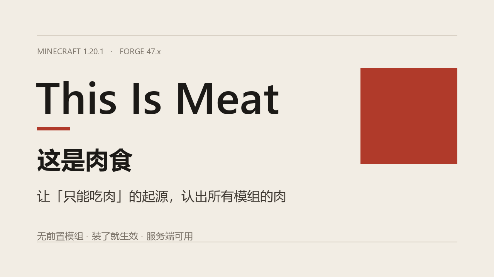

# 这是肉食 (This Is Meat)




使食肉类的起源和能力正确识别其他模组添加的肉食。

Makes carnivore-style origins and powers actually recognise meat added by other mods.

> 代码与文案由 AI 辅助完成，作者负责测试与调整。
> 欢迎拿去喂 AI 做其他版本的，或者干任何事。

---

## 问题背景 / The problem

Origins/Apoli 的 `origins:meat` 条件读的是物品的 `FoodProperties.isMeat` **标志位**，  
而不是物品标签（`origins:meat` 那个标签是由 `origins:ingredient` 单独读取的）。

绝大多数模组在注册食物时不会调用 `FoodProperties.Builder#meat()`，于是：

- 奇异饰品的**永恒牛排 / 持久牛肉** → 被判成“不是肉”
- 农夫乐事、暮色风味乐事、幻想乡乐事、末地乐事的大量肉菜 → 同样判成“不是肉”
- 结果就是 Hell's Gate Origin 的 `Carnivore` 权力把它们的饥饿值与饱食度乘 0，吃了等于没吃

`origins:meat` reads the `FoodProperties.isMeat` flag, **not** an item tag. Modded food  
usually never sets that flag, so carnivore checks treat it as vegetable and zero out the  
hunger/saturation.

## 这个模组做什么 / What this mod does

启动后扫描物品注册表，找出“看起来是肉”的食物，然后**把 `isMeat` 标志位写回物品本身**。  
它不修改任何其他模组的数据文件，也不依赖 Origins / Hell's Gate —— 装了就生效，  
不装则完全无副作用。

It scans the item registry for food that looks like meat and rewrites that item's  
`FoodProperties` with `meat = true`. No data files are overridden, no dependency on  
Origins or Hell's Gate.

### 三段判定 / Three detection stages

| 阶段 | 时机 | 依据 |
| -- | ----------- | --------------------------------------------------------------------- |
| 1 | 游戏启动后（主菜单前） | 物品注册 ID，例如 `artifacts:eternal_steak`、`alexsmobs:cooked_kangaroo_meat` |
| 2 | 进入世界后 | 配方图：只要某配方用到了肉，产物也算肉（覆盖“饺子”“寿司卷”“汉堡”这类名字里没肉字的菜） |
| 3 | 客户端进入世界后 | 翻译后的显示名（中/英关键词），补上 ID 没线索的物品 |

第 2 段会连跑两轮，因此 `生肉 → 熟肉 → 肉菜` 这条链能一路传下去。

### 内置关键词 / Built-in keywords

- 肉类：meat / beef / pork / mutton / chicken / steak / bacon / sausage / venison / jerky / rib / wing / liver …
- 水产：fish / salmon / cod / trout / tuna / squid / shrimp / crab / lobster / oyster / mussel …（原版 `origins:meat` 标签本身就把鱼算作肉）
- 中文：肉 / 鱼 / 虾 / 蟹 / 火腿 / 培根 / 香肠 / 排骨 / 鸡腿 / 肝 / 骨髓 …
- 排除项：素肉、植物肉、人造肉、`vegan`、`seitan` 等，避免把仿荤食品判成肉

## 配置 / Config

`config/thisismeat-common.toml`

```toml
[general]
    enabled = true
    match_item_id = true
    match_recipes = true
    match_display_name = true

[rules]
    extra_keywords = []
    whitelist = []      # "modid:item_id" 或 "modid:*"
    blacklist = []      # 同上，优先级高于所有规则
    log_results = true
```

## 命令 / Commands

| 命令 | 作用 |
| ------------------- | --------------------- |
| `/thisismeat list`   | 列出被标记的物品及判定依据（前 40 条） |
| `/thisismeat status` | 只显示被标记的总数 |

需要权限等级 2（单人游戏开作弊即可）。

## 安装 / Install

把 `thisismeat-1.20.1-1.0.0.jar` 丢进 `mods/` 即可。**没有前置要求** ——  
不需要 Origins、不需要 Hell's Gate、不需要任何库。

- 单机：直接生效
- 服务器：装服务端（第 1、2 段），客户端可选（第 3 段只影响显示名判定）
- 卸载：直接删 jar，不残留任何数据（改动只存在于内存中的物品属性，不会写进存档）

## 兼容性 / Compatibility

- Minecraft **1.20.1**，Forge **47.x**
- 不声明任何硬依赖：没装 Origins / Hell's Gate 时它只是一个“把模组食物标记为肉”的工具
- 在 Sinytra Connector（Forge 载 Fabric 模组）环境下正常工作
- 服务器端可用：纯服务端会跑第 1、2 段，客户端跑第 3 段
- **副作用**：任何读取 `isMeat` 的模组都会看到这些食物是肉（例如某些模组的食肉动物喂养判定）。这在语义上是正确的；若你不想影响某个物品，把它加进 `blacklist`

## 实现说明 / Implementation note

`Item` 的 `FoodProperties` 字段是 `private final`，且 Forge 运行时使用 SRG 名称，  
所以模组**按类型反射查找**该字段（不依赖任何混淆名），再用 `FoodProperties.Builder`  
构造一份 `meat = true` 的副本替换进去。整个过程在游戏启动时一次性完成，运行时零开销。

写入后会立刻读回校验。万一反射被拒绝（个别环境会禁止改写 `final`），会自动降级为  
`sun.misc.Unsafe` 直接写内存槽；两条路都不通时只在日志里报一次错，不会刷屏，也不会崩游戏。

## 构建 / Building

需要 **JDK 17**。Gradle 不用自己装，仓库自带 wrapper。

```bash
./gradlew build
# 产物: build/libs/thisismeat-1.20.1-1.0.0.jar
```

如果 `maven.minecraftforge.net` 连不上或很慢，在项目根目录建一个 **不入库** 的
`local.properties`，指向一个能用的镜像：

```properties
mirrorMaven=https://bmclapi2.bangbang93.com/maven
```

## 许可 / License

MIT，见 [LICENSE](LICENSE)。
